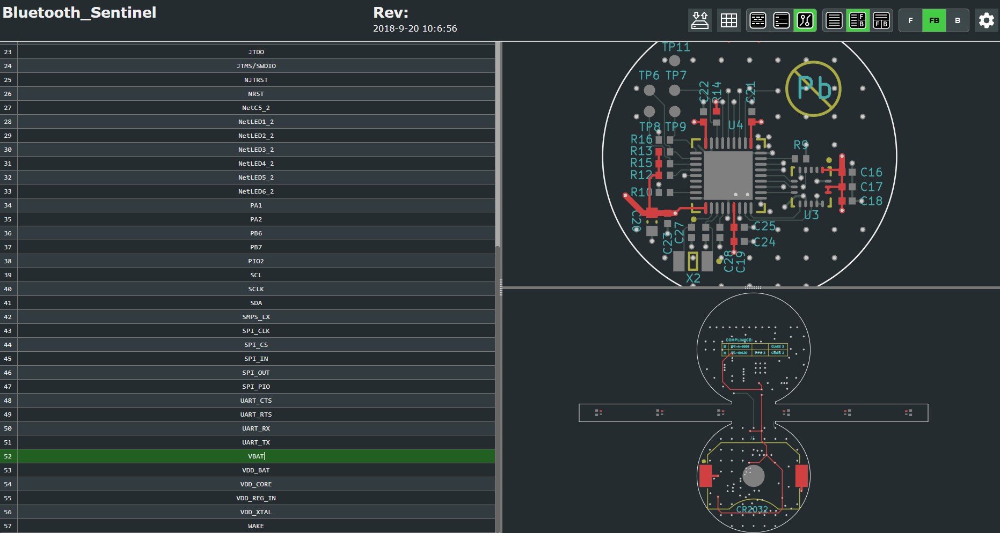

---

## 26/11/22 更新内容

### 网络表模式 [issue #8](https://github.com/lianlian33/InteractiveHtmlBomForAD/issues/8)

- 设置窗口启用“包含网络”选项，勾选后生成的数据包含网络信息；勾选状态保存到 config.ini，重新打开窗口时自动恢复。
- PCB 解析阶段为焊盘、走线（含圆弧转换的线段）、过孔、填充、区域和铺铜多边形写入所属网络名，并汇总去重后生成 `pcbdata.nets`。
- HTML 查看器自动显示网络表视图：
  - 点击网络行可在 PCB 视图高亮该网络的所有走线、铺铜和焊盘；
  - 点击画布上的焊盘或走线可反向选中对应网络行；
  - 网络名支持搜索过滤和排序。
- 未勾选“包含走线/区域”时，网络表只能高亮焊盘；需要同时高亮走线和区域时需勾选该选项。
- 修复浏览器残留网络表显示模式记录、但新生成的 HTML 不包含网络数据时导致崩溃的问题。

> 提示：网络数据会增大生成文件体积，尤其是勾选“包含走线/区域”后，生成所需时间会大幅增加。

