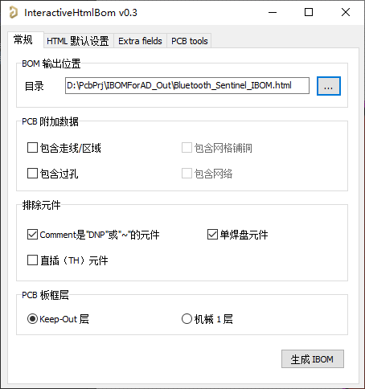
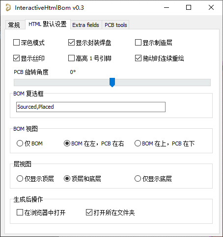
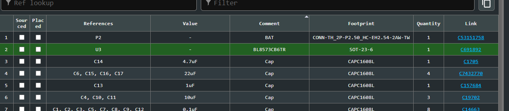
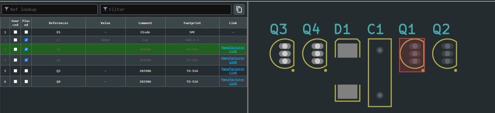

## 26/11/18 更新内容

### 界面中文化

- 设置窗口的“General”和“HTML defaults”两个标签页以及生成的HTML已全部翻译为中文。

   

### BOM 表格增强

- 新增 **Comment** 列：显示元件的 Comment 值；
- **Value** 列改为显示原理图中元件的 Value 字段（尝试了在PcbDoc里获取但没有成功），未填写时显示“-”。
- AD 中元件的 Value 或 Comment 为空时统一显示“-”，Comment为空时不再受“排除元件”的影响而隐藏。
- 新增 **Link** 列：以元件的 `ComponentLink1Description` 参数作为显示文字，带超链接，点击可跳转到 `ComponentLink1URL` 指定的链接，在新标签页打开。
  - 整块 PCB 中没有任何元件同时具备 `ComponentLink1Description` 和 `ComponentLink1URL` 参数时，不生成Link列。
  - 链接不同的元件会自动分成独立的 BOM 行，避免信息混淆。
  - 该列固定位于 BOM 表格最后一列。

### PCB 视图支持勾选变暗

  - 在 HTML 查看器设置中选择"勾选后变暗"对应的勾选列（如 Placed）后，
    被勾选的元件焊盘会在 PCB 视图中同步变暗，未勾选元件保持原样。
  - 变暗状态保存在浏览器本地，重新打开页面会自动还原。
  - 变暗元件被鼠标悬停/选中高亮时，只显示红色边框和半透明红色背景，
    不再把焊盘高亮为红色。

> 提示：该效果依附于设置中选中的"勾选后变暗"列；若未选择该列或未生成任何勾选列，则 PCB 视图不会变暗。

### 网络路径支持

- 支持导出到网络共享位置（如 `\\服务器\共享目录`），可直接在目录框输入或通过浏览按钮选择。

### 生成后操作

- “在浏览器中打开”和“打开所在文件夹”两个选项已可用，可按需勾选，并会记住上次的选择。
- 生成完成后，按钮左侧会出现“导出完成”提示，直到下一次点击生成时清除。

### 稳定性与功能修复

- 当工程中没有可读取的原理图时，会自动放弃读取相关参数，不再生成依赖原理图的列（包括 `Value` 和 `Link` 列），也不会提示错误。
- 重新生成的 HTML 会按设置窗口里的最新选择初始化显示效果，不再被浏览器记住的旧显示状态覆盖。

  > 提示：修改设置后需重新生成一次 IBOM 才会生效。

---

## 26/11/21 更新内容

### 元件数量统计修正

- 修复统计面板元件总数恒定比实际多 1 的问题；
- 勾选框统计的进度总数同步修正；

### 修复BOM表排序问题

- 使用自然排序：忽略大小写，字母数字混合时结合数值比较（如 `C2` 排在 `C10` 前、`MSOP-8` 排在 `MSOP-10` 前）。
- References、Comment、Footprint、Link等列统一使用自然排序。
- 默认 BOM 行顺序由倒序改为正序。

### 导出工具修复

- **exportBOM**
  - 输出改为逗号分隔的 CSV 文件，导出后动作改为自动打开所在文件夹；
  - 列调整为 `Comment, Value, Soldertype, Footprint, Quantity, Designator, TopLayer, BtmLayer`；
  - Comment 列改为元件真实的 Comment 值（之前是 Value），并新增独立的 Value 列；
  - 字段包含逗号、引号或换行时自动加引号转义，Excel/WPS 可直接打开。

- **exportPnP**
  - 修复可能导致运行时异常的Bug；
  - Comment 列改为元件的 Comment 值，底层元件图层标记统一为 `T`/`B`；
  - 字段同样做 CSV 转义。

### main() 入口支持读取 config.ini

- `main()` 现在按 `config.ini` 生成 HTML，读取项与设置窗口一致；
- 没有 `config.ini` 时，使用与设置窗口首次打开时相同的默认值；
- “直插（TH）元件”排除选项默认改为不勾选。

### 其他修复

- 给辅助函数添加占位参数以使其在AD的“运行脚本”窗口中隐藏；
- 将插件的默认输出路径由`PnPout`改为`IBOMForAD_Out`，并在默认输出文件名后追加相应的`_XXX`后缀（例如`PCB-Project_IBOM.HTML`）。
